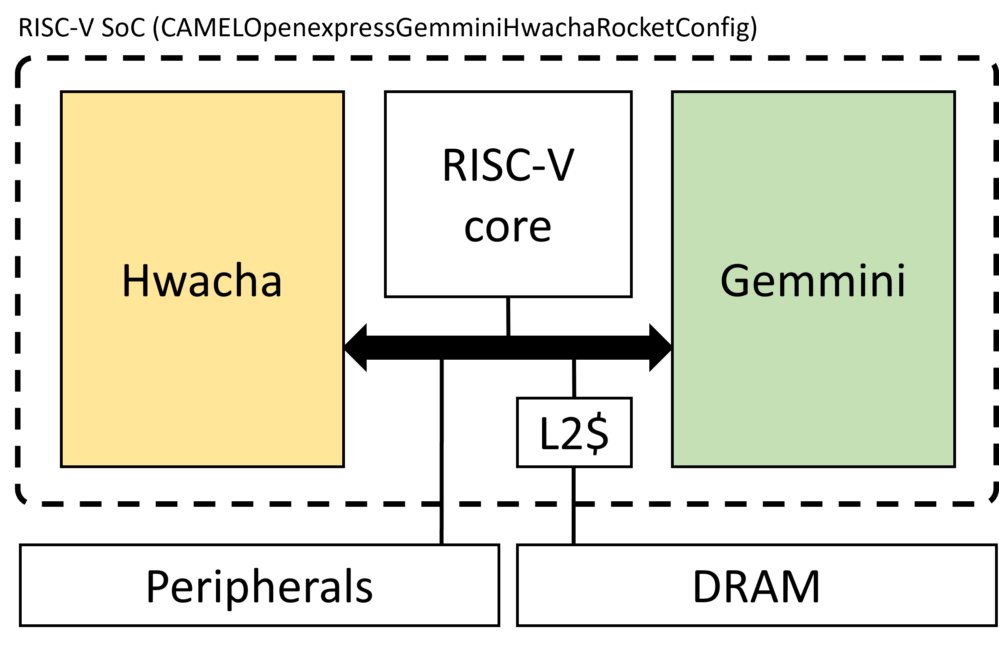
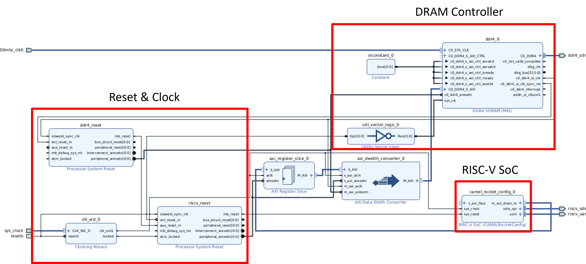

# CAMEL SSD Controller

## SSD Controller Structure
This SSD controller is composed of RISC-V CPU (Rocket), DNN accelerator (Gemmini), Vector processor (Hwacha). You have to connect DRAM controller and peripherals to run this SSD controller.

  

## How-to
1. Create your Vivado project
2. Add SSD controller IP. You can find how to add IP in Vivado project in here(https://camel.kaist.ac.kr/hjchoi/acc_ip).
3. Add proper IPs to run Linux or any other OS. You have to choose suitable IPs for your FPGA. Example of the setting for Alveo U200 is below.
 

The IPs that are used in this setting are as follows:
* Reset & Clock
  * Processor System Reset (https://www.xilinx.com/products/intellectual-property/proc_sys_reset.html)
  * Clocking Wizard (https://www.xilinx.com/products/intellectual-property/clocking_wizard.html)
* DRAM Controller
  * DDR4 SDRAM (MIG) (https://www.xilinx.com/products/intellectual-property/mig.html)
  * Utility Vector Logic (https://www.xilinx.com/products/intellectual-property/util_vector_logic.html)
* Etc.
  * AXI Data Width Converter (https://docs.xilinx.com/r/en-US/pg059-axi-interconnect/AXI-Data-Width-Converter)
  * AXI Register Slice (https://www.xilinx.com/products/intellectual-property/axi-register-slice.html)

## Acknowledgment
This project is funded by IITP 2021-0-00524
